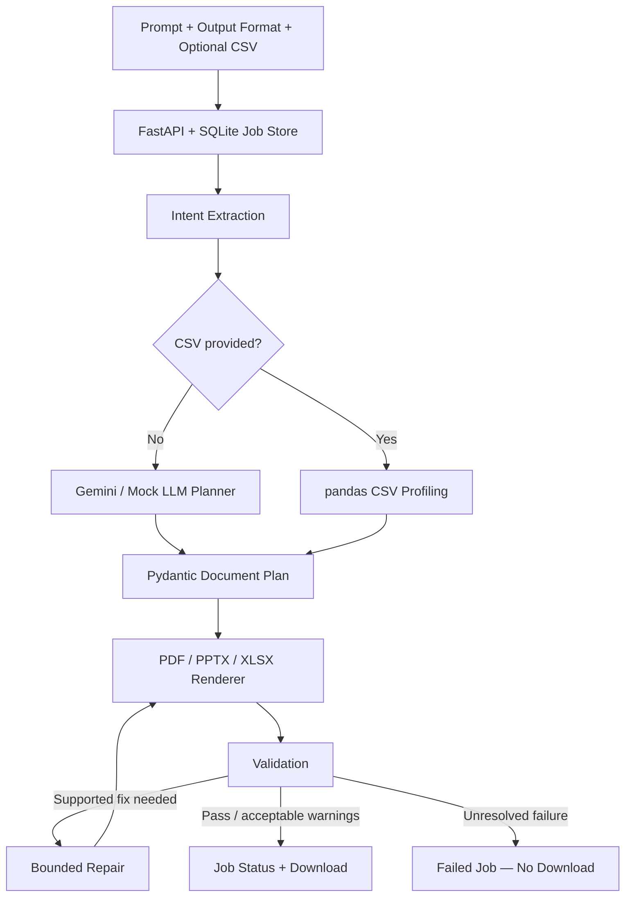

<div align="center">

# ✦ Doxify

### AI-Powered Document Generation Engine

**From a simple prompt to a polished PDF, PowerPoint, or Excel workbook.**


**[Overview](#-overview) · [Architecture](#-architecture) · [Setup](#-quick-start) · [Testing](#-testing--environment) · [Limitations](#-limitations--future-scope)**

</div>

---

## ✨ Overview

**Doxify** is a FastAPI-based prototype built for the **Build an AI-Powered Document Generation Engine** assignment. It interprets natural-language requests, creates a validated document plan, renders a downloadable file, and checks the output before making it available. Optional CSV uploads support data-driven reports and workbooks.

### Core capabilities

| | Feature | What it does |
|:--:|---|---|
| 📄 | **Multi-format output** | Generates PDF reports, PowerPoint presentations, and Excel workbooks. |
| 🧠 | **Prompt interpretation** | Extracts supported format, audience, sections, and page/slide requirements. |
| 🧩 | **Structured planning** | Uses Pydantic schemas to separate AI planning from deterministic rendering. |
| 📊 | **CSV-powered analysis** | Uses pandas for summaries, charts, and supported calculations. |
| 🛡️ | **Validation & repair** | Checks supported structural, numerical, formula, and text requirements; attempts bounded repairs. |
| ⚙️ | **Job management** | Tracks statuses in SQLite, deduplicates requests, and gates downloads on completion. |
| 🌐 | **Web interface** | Provides prompt entry, format selection, optional CSV upload, status, and download. |

> **Supported CSV calculations:** Profit, Profit Margin, Expense Ratio, and Net Cash Flow. Custom formulas outside the supported rules are not yet available.

## 🏗️ Architecture



**Key design choices**

- **Plan before rendering:** Gemini (or Mock LLM) produces structured content; Python renderers create the files.
- **Deterministic CSV path:** CSV-based plans are built from pandas profiling rather than Gemini. Supported numerical checks are rule-based, not universal fact-checking.
- **Spreadsheet safety:** Formulas use a restricted set of operations; potentially dangerous cell text is escaped.
- **Bounded repair:** Rule-based fixes are attempted up to `MAX_REPAIRS` (default: 2), rather than making unlimited AI calls.
- **Safe download states:** Failed jobs do not expose downloadable files. Deduplication can cause an identical retry to reuse an existing failed job.

## 🛠️ Tech stack

| Layer | Technologies |
|---|---|
| **API & orchestration** | Python 3.11, FastAPI, Uvicorn |
| **AI & schemas** | Google Gemini (configurable), Mock LLM, Pydantic |
| **Data & persistence** | pandas, SQLite (`sqlite3`) |
| **Document generation** | ReportLab, python-pptx, openpyxl |
| **Validation** | pypdf, format-specific validators, rule-based checks |
| **Frontend & tests** | HTML, CSS, JavaScript, pytest |

## 📁 Project structure

```text
Doxify/
├── app/
│   ├── main.py                 # FastAPI endpoints and UI
│   ├── config.py               # Environment configuration
│   ├── intent.py               # Prompt requirement extraction
│   ├── prompts.py              # LLM instructions
│   ├── llm.py                  # Gemini and Mock LLM
│   ├── planner.py              # Structured document planning
│   ├── schemas.py              # Pydantic models
│   ├── data_profile.py         # CSV profiling and calculations
│   ├── pipeline.py             # Generation and validation flow
│   ├── repair.py               # Bounded repair rules
│   ├── jobs.py                 # SQLite job records
│   ├── service.py              # Background job execution
│   ├── security.py             # Spreadsheet input protection
│   └── limits.py               # Resource and time limits
├── renderers/                  # PDF, PPTX, XLSX, charts, layout, theme
├── validators/                 # Format, text, numeric, requirement checks
├── static/index.html           # Web interface
├── tests/                      # Automated and failure-path tests
├── samples/                    # Sample CSV inputs
├── demo/                       # Example generated output
├── list_models.py              # Gemini model helper
├── test_gemini_connection.py   # Gemini connectivity helper
├── data/                       # Local runtime data (not committed)
├── .env.example
├── .gitignore
├── requirements.txt
└── pytest.ini
```

## 🚀 Quick start

**Requirements:** Python 3.11. SQLite is included through Python's `sqlite3` module; LibreOffice is optional.

**1. Create an environment and install dependencies**

```powershell
py -3.11 -m venv .venv
.\.venv\Scripts\Activate.ps1
pip install -r requirements.txt
```

**2. Configure the LLM**

Copy `.env.example` to `.env` and choose one mode:

```dotenv
# Real Gemini
LLM_PROVIDER=gemini
MOCK_LLM=false
LLM_API_KEY=your_private_api_key
```

Or use the offline mock provider:

```dotenv
LLM_PROVIDER=mock
MOCK_LLM=true
```

**3. Launch Doxify**

```powershell
python -m uvicorn app.main:app --reload
```

**Web app:** http://127.0.0.1:8000 · **API docs:** http://127.0.0.1:8000/docs

> **Security:** Never commit `.env` or API keys. Mock mode uses fixed template content and is not evidence of Gemini's real-world writing quality.

## 🧪 Testing & environment

**Previously observed result: 98 passing pytest cases** in a compatible development environment. This is not a guarantee for every machine, input, or live LLM response.

| Area | What the result means |
|---|---|
| **Coverage** | Tests cover intent extraction, schemas, API, renderers, validators, limits, spreadsheet safety, and failure paths. |
| **Mock fallback** | Most tests use Mock LLM; passing them does **not** verify Gemini-generated content quality. |
| **Python version** | Python 3.11 is recommended. An attempted run under system Python 3.9 failed during collection because the installed ReportLab requires Python 3.10+. |
| **LibreOffice** | Optional. Formula-recalculation tests may be **skipped** without it; `openpyxl` does not calculate formulas. |
| **Validation scope** | Automated checks do not guarantee perfect layout, factual accuracy, or correct output for every prompt. |

## 🔭 Limitations & future scope

| Current limitation | Planned direction |
|---|---|
| Text checks focus on structure and heuristics, not deep factual or semantic correctness. | Secondary content-quality validation. |
| Intent extraction relies partly on patterns; CSV calculations are predefined. | More flexible requirement parsing and safe dynamic formulas. |
| Exact PDF page targets can create whitespace; overflow detection is limited. | Adaptive pagination and stronger layout checks. |
| Themes are code-defined; automatic PDF imagery and in-app previews are limited. | Selectable themes, richer visuals, preview/edit workflow. |
| Failed jobs are not automatically recovered; heavy concurrency is unverified. | Durable workers, retries, and load testing. |
| No authentication, per-user access controls, rate limiting, or retention policy. | Production-grade access control and operational safeguards. |

---

<div align="center">

**Doxify is an engineering prototype, not a production-ready document service.**  
*Generated documents should be reviewed before important use.*

</div>
